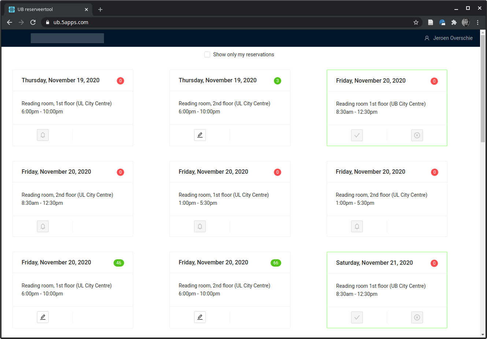
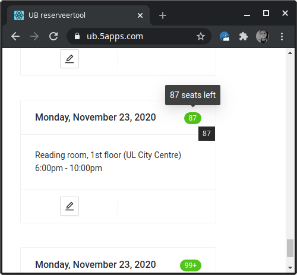
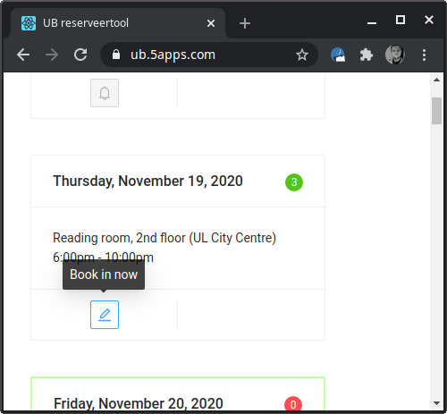

# UB reserveertool
By Jeroen Overschie


<table>
  <tr>
    <td colspan="2"></td>
  </tr>
  <tr>
    <td>
        
    </td>
    <td>
        
    </td>
  </tr>
</table>

## Pushing backend to Docker Hub
1. `docker build -t ub-backend .`
2. `docker tag ub-backend:latest dunnkers/ub-reserveertool:backend`
3. `docker push dunnkers/ub-reserveertool:backend`
4. `kubectl delete deployments/ub-backend`
5. `kubectl apply -f gcp.yaml`


```shell
docker build -t ub-backend .
docker tag ub-backend:latest dunnkers/ub-reserveertool:backend
docker push dunnkers/ub-reserveertool:backend
kubectl delete deployments/ub-backend
kubectl apply -f gcp.yaml
```

## Backend usage

Test using curl as such:

```shell
curl localhost:3001/reservations -H "Content-Type: application/x-www-form-urlencoded" -X POST -d "email=..."
```

```
curl https://studieplek-reserveren.herokuapp.com/regloop -H "Content-Type: application/x-www-form-urlencoded" -X POST -d "event_id=...&email=...&startdt=..."
```

Cancelling events
```shell
curl https://libcal.rug.nl/ajax/event/cancel/2364883\?w\=0\&c\=7cd9e94a3421f8ab305f794ecff0c0c1\&rm\=0 -X POST -H "Referer: https://libcal.rug.nl/event/cancel/2364883?c=7cd9e94a3421f8ab305f794ecff0c0c1"
```

Register account
```shell
curl https://studieplek-reserveren.herokuapp.com/add_account -H "Content-Type: application/x-www-form-urlencoded" -X POST -d "email=..."
```

### Redis cluster on Kubernetes

```
helm install my-redis bitnami/redis --set cluster.enabled=false --set master.persistence.size=1Gi
```

Get redis password
```
export REDIS_PASSWORD=$(kubectl get secret --namespace default my-redis -o jsonpath="{.data.redis-password}" | base64 --decode)
echo $REDIS_PASSWORD
```

### Redis commander
```
code /usr/local/lib/node_modules/redis-commander/config/local-development.json
```

Usage
```
redis-commander
```

> add more connections to have them also show up in the interface.

### DigitalOcean node

```shell
pm2 logs main --lines 150
pm2 status
SOME_VAR=<some_value> pm2 restart main --update-env
```


### Deploying to 5apps

```shell
yarn deploy
```